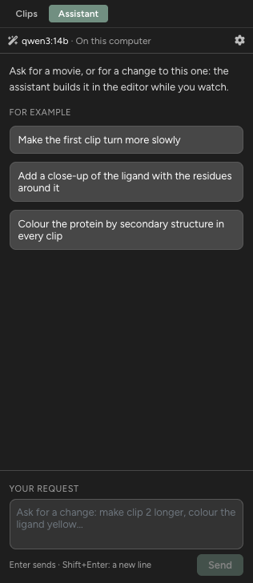
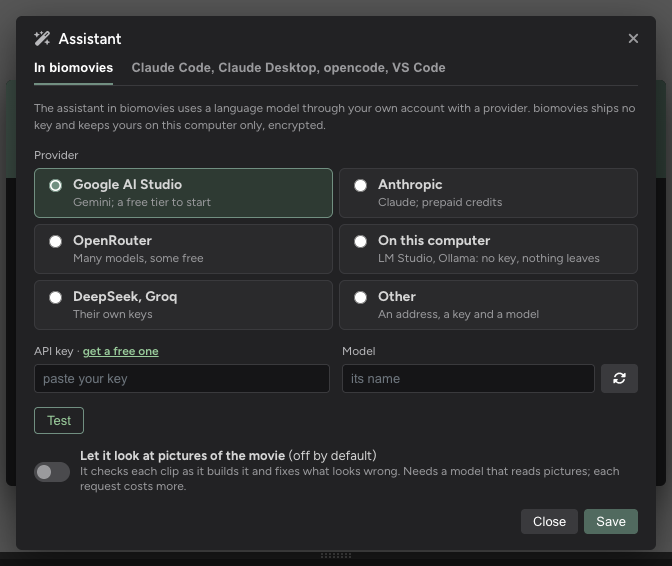
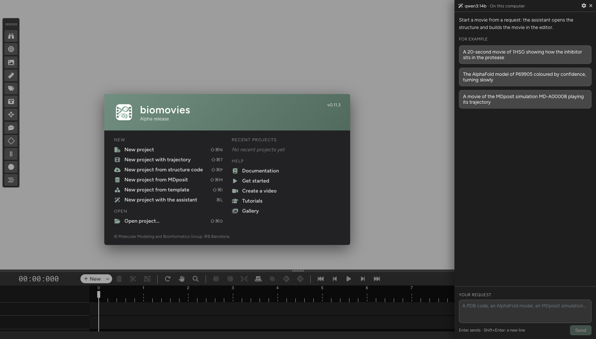
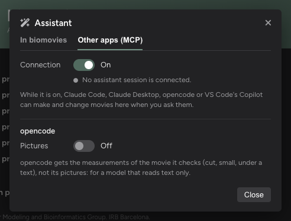

# AI assistants

An **AI assistant** can build and change movies in biomovies for you: ask it (*"make a 20-second movie of 1HSG showing
how the inhibitor sits in the protease"*) and watch the movie being made in the editor. It opens the structure, plans
the clips, builds them, looks at the result and corrects it.

There are two ways:

* **The assistant in biomovies**: a panel in the editor, with a language model from a provider you choose (Google,
  Anthropic, OpenRouter, a model on your own computer...). See [The assistant in biomovies](#the-assistant-in-biomovies).
* **Assistants in other apps**, connected to biomovies: see [Assistants in other apps](#assistants-in-other-apps).

biomovies includes no AI and no account of its own: you use your own key or account, and the provider's plan applies.

## The assistant in biomovies

The assistant's panel, in the editor's right column

### Setting it up

Assistant > Connection…, In biomovies

**Assistant > Connection…**, tab **In biomovies**:

1. Choose a **provider**:

   | Provider | What to know |
   | :-- | :-- |
   | **Google AI Studio** | Gemini models, with a free tier to start (a key at [aistudio.google.com/apikey](https://aistudio.google.com/apikey)). The newest models are often overloaded; an older *Flash* one usually answers. |
   | **Anthropic** | Claude models, with prepaid credits in Anthropic's console. Claude Opus is the most capable; Sonnet and Haiku cost less. |
   | **OpenRouter** | Many models from many companies under one key. Choose a large, recent model that takes tools; the free ones (`:free`) allow only a few requests a day. |
   | **On this computer** | A model running in LM Studio or Ollama: no key, nothing leaves the computer. On a laptop a request takes minutes; give the model a context length of at least 32k. |
   | **DeepSeek, Groq** | Their own keys. Groq's free tier allows too few tokens a minute for the assistant. |
   | **Other** | Any server that speaks the OpenAI chat API: its address, a key if it needs one, and a model. |

2. Paste your **API key** (the link next to it says where to get one). biomovies keeps it on this computer only,
   encrypted by the system; it is never in a project and never sent anywhere but to the provider.
3. Choose a **model**. The list shows only the models that can chat and use tools; the refresh button asks the
   provider for its list again.
4. **Test**: biomovies asks the model a short question and says whether it answered, whether it uses tools (the
   assistant needs them) and whether it reads pictures.
5. **Let it look at pictures of the movie** (off by default): the assistant then checks the pictures of what it built
   and fixes what looks wrong. It needs a model that reads pictures, and each request costs more.
6. **Save**.

On **macOS**, the first time biomovies uses the saved key it asks to use its keychain entry, *"biomovies Safe Storage"*:
type your Mac's password and choose **Always Allow**. After an update of biomovies, macOS may ask once more.

**What it costs.** Each step of the assistant sends the model about 18,000 tokens (the tools and the guide), and a
movie takes 10 to 30 steps. A free tier with a small limit per minute may refuse it (the message says so). With
Claude, a movie costs from cents (Haiku) to a dollar or two (Opus), roughly. The panel says what each request used.

### The panel

New project with the assistant, on the start screen

* **Open it** with the **Assistant** tab of the editor's right column (beside **Clips**), with **Assistant > Assistant
  Panel** (⌘L on macOS, Ctrl+L on Windows and Linux), or with **New project with the assistant** on the start screen.
  Without a model or a key, the panel offers **Set up the assistant**.
* **Ask**: type your request and press Enter (Shift+Enter for a new line), or click one of the examples. On the start
  screen, the request creates the project; in the editor, it changes the movie open.
* **Before your first request** (once each time biomovies opens), a window says what goes to the provider (what you
  write, a summary of the structure, the movie's outline, its pictures if *Pictures* is on) and what does not (the
  structure and trajectory files, the project file). **Continue** sends the request, **Not now** keeps it in the box;
  tick **Do not show this again** to skip it from then on.
* **While it works**, the editor is locked and the panel shows each step as it happens. **Stop**, or Esc, stops it.
* **When it is done**, it says what it made. Under its answer:
  * **N steps**: click to see what it ran, and what failed;
  * **Undo all of it**: undoes the whole request in one go, while nothing has been changed since (after that, use
    **Edit > Undo** step by step);
  * **Preview the movie**: plays it from the start;
  * how many calls to the model the request took, and about how many tokens.
* The conversation lasts while biomovies is open (it is not saved in the project): the assistant remembers your earlier
  requests. The broom button starts a new conversation; the gear opens the settings.

## Assistants in other apps

biomovies works with four assistants of other apps, which you use with your own account:

* **Claude Code** (Anthropic's assistant in the terminal, or in VS Code);
* **Claude Desktop** (its chats, Cowork and its Code tab);
* **opencode** (with any model it can reach, including models running on your own computer or your institution's
  servers);
* **VS Code's Copilot** (its chat in Agent mode).

### Connecting an assistant

Assistant > Connection…, Other apps (MCP)

**Assistant > Connection…**, tab **Other apps (MCP)**, on the start screen or in the editor. (MCP, the Model Context
Protocol, is the standard these apps use to reach biomovies' tools.)

1. Turn the **Connection** on. While it is on, the assistants can work on the open project (or start one from the
   start screen) when you ask them. biomovies remembers it, also after a restart, until you turn it off.
2. For each assistant installed on this computer that does not have the biomovies tools yet, the window offers a
   button: **Add to Claude Code**, **Add to Claude Desktop**, **Add to opencode** or **Add to VS Code**. Done once per
   assistant.
3. Start a new session of the assistant (Claude Code, opencode), reopen Claude Desktop, or open VS Code's chat in Agent
   mode: biomovies' tools are now among its tools.

A few details:

* **Claude Desktop** must be closed while you add biomovies to it: it keeps its settings in the same file.
* **opencode** and **Claude Desktop** settings are edited only if they are plain files biomovies can read; a copy of
  the file as it was stays next to it (*.biomovies-backup*).
* **VS Code** asks you to trust the biomovies server the first time it starts it.
* When adding fails, the window shows the lines to paste (or the command to run) instead, with a **Copy** button.
* When biomovies is moved or updated, the window may say an assistant's tools *run a copy of biomovies that is no
  longer there*: click **Update** next to it.

### Asking for a movie

Ask in plain words, in the assistant's chat:

* *"Make a movie of PDB 1HSG: the whole protease, then a close-up of the inhibitor."*
* *"The AlphaFold model of P69905 coloured by confidence, turning slowly."*
* *"Make clip 2 longer and colour the ligand yellow."* (on the open project)

Claude Code, opencode and Copilot also offer two ready requests:

| Request | Claude Code, opencode | VS Code's Copilot | What happens |
| :-- | :-- | :-- | :-- |
| **movie** | `/biomovies:movie 1HSG` | `/mcp.biomovies.movie` | The assistant proposes a plan for a movie of that structure and builds it when you agree. |
| **paper** | `/biomovies:paper` followed by the PDF's path | `/mcp.biomovies.paper` | It reads the paper, finds its structure, proposes a storyboard with the paper's own words and builds it when you agree. |

In Claude Desktop, ask in plain words: its chats do not list these requests.

A few things to know:

* **New movies** start from the start screen: if a project is open, the assistant asks you to save and close it first.
* For a **PDB entry** whose biological assembly differs from the structure as deposited, the assistant asks which one
  you want.
* A movie shows **one structure**: comparing two (with and without a drug) is not possible yet.

### While it works

While the assistant changes the movie, a card at the top says what it is doing, and the editor is locked so that
nothing changes under it; you watch the movie being built. To stop it, stop the assistant in its own window (Esc in
Claude Code); if the editor stays locked, the card says when it unlocks, or press **Esc** on it.

When it is done:

* **Edit > Undo** (⌘Z, Ctrl+Z) undoes the **whole request** in one step.
* Everything it made can be changed in the editor as usual.
* The assistant tells what it made, clip by clip, what it checked and what it corrected.

### Pictures

To check its work, the assistant looks at pictures of the movie's key moments, with measurements of how its subject
sits in each one (cut at an edge, too small, under a text).

* **Claude Code**, **Claude Desktop** and **Copilot** get the pictures.
* **opencode** gets the measurements only, as many of its models read text only. With a model that reads images, turn
  **Pictures** on under opencode in **Assistant > Connection…**, tab **Other apps (MCP)**.

## Scripts

What an assistant does, in biomovies or in another app, is a list of the editor's commands. biomovies can keep that
list as a **script**, a small .json file, and run it again later.

### Saving one

**Assistant > Save the Assistant's Commands as Script…** saves every command the assistants ran since biomovies was
opened, in order, with your requests as its description. Only the commands that worked are kept, and those of a
request you undid afterwards too: save right after the requests you want to keep, or start biomovies again first.

### Running one

**Assistant > Run Script…** asks for the .json file and runs it:

* **On the start screen**: a script that starts by creating the project (all those saved from a new movie do) makes
  the project and builds the movie in it.
* **In the editor**: the script changes the open project. Everything it does is **one undo step** (**Edit > Undo**).

It runs the commands one after the other and **stops at the first one that fails**, saying which and why; what ran
before it stays (and is undone in one step). Next to the script, biomovies writes what each command gave
(*\<script\>.results.json*) and the pictures some commands take (*\<script\>.screenshot-\<n\>.png*).

### What for

* **The same movie again**, on another computer or after a change in biomovies, without asking an assistant (and
  without paying for it again).
* **Sharing how a movie was made**: send the script with the paper or to a colleague.
* **A starting point**: run it on the start screen and change the movie in the editor, as with a template (for a
  template of your own that fits any structure, see [Templates](templates.html)).
