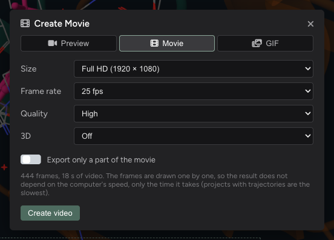

# Exporting videos

The export window

The **Create Video** menu makes a video of the movie, frame by frame, at the size you choose: the result does not
depend on your screen or on the size of the window, and nothing is recorded from the screen.

| Menu entry | Shortcut | Starts with |
| :-- | :-- | :-- |
| **New Preview** | ⌘P, Ctrl+P | A quick MP4: 720p, medium quality. |
| **New Movie** | ⌘M, Ctrl+M | The final MP4: Full HD, high quality. |
| **New GIF** | ⌘G, Ctrl+G | An animated GIF: 800 × 450, 12.5 frames per second. |

All three open the same **export window**, each with its own starting settings; the tabs at its top switch between
them, and each remembers what you last chose.

## The settings

| Setting | Choices |
| :-- | :-- |
| **Size** | MP4: 720p (1280 × 720), Full HD (1920 × 1080), QHD (2560 × 1440) or 4K (3840 × 2160). GIF: from 480 × 270 to 1024 × 576. A size this computer cannot encode is marked *not available here*. |
| **Frame rate** | MP4: 25 or 12.5 frames per second. GIF: 12.5, 8.3 or 5. |
| **Quality** | MP4 only: *Medium*, *High* or *Very high* (bigger files). |
| **3D** | MP4 only: a stereoscopic video (see [3D videos](#3d-videos)). |
| **Export only a part of the movie** | Off: the whole movie. On: see [A part of the movie](#a-part-of-the-movie). |

Videos are 16:9. The video shows the same height as the stage; only the sides depend on the stage's shape. Turn on the
**Video frame** tool on the stage (see [The stage](editor-stage.html#the-tools-strip)) while you set the cameras: it
shows the sides a video leaves out.

Every frame carries the descriptions, and a small, faint biomovies logo in the bottom right corner.

## Making it

**Create video** (or **Create GIF**) starts. The window shows the progress, and **Cancel** stops it. A movie without a
trajectory goes fast; with a trajectory, each frame takes longer, as the structure is rebuilt at each frame.

When it is done, the window plays the result and says its size, frame rate and length. Nothing is written to disk until
you click **Save…**; then **Show in folder** finds it. **New export** goes back to the settings, to make another one.
Closing the window before saving asks first.

## A part of the movie

With **Export only a part of the movie** on, the window shows the movie's clips in small, with two handles for where
the video starts and ends:

* drag a handle: it snaps to the edges of the clips, transitions and descriptions near it (hold Alt to put it
  anywhere), and the stage shows that moment;
* click a block to take just that block, Shift+click to extend the part to another;
* type a clip number or a time in seconds in **From** and **To**;
* zoom with the wheel or a pinch, and double-click an empty part to see the whole movie again.

The part chosen is kept while the switch is off, until the project is closed.

## 3D videos

**3D** makes a stereoscopic video, with one picture for each eye:

| Layout | For |
| :-- | :-- |
| **Side by side, half width** | 3D TVs and VR headsets: set the TV or the player to side-by-side 3D. |
| **Side by side, full width** | Players that take each eye at full size: the frame is twice as wide, and it takes about twice as long to make. |
| **Top and bottom, half height** | TVs and players set to top-and-bottom 3D. |
| **Anaglyph** | Red / cyan glasses, on any screen; the colours change a little. |

**Depth** sets how strong the 3D is, and **Screen plane** how far the screen sits in the scene: what is in front of it
comes out of the screen, what is behind goes in. The descriptions stay on the screen plane. A still of the movie in 3D
shows the effect before you start.
