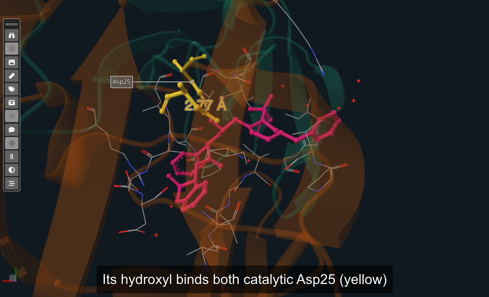
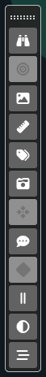
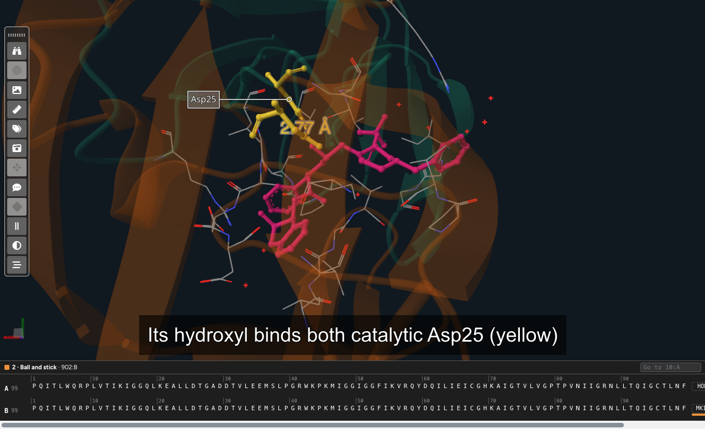

# The stage

The stage, with a label (Asp25) and a distance

The **stage** shows the structure as it looks at the timeline cursor. What the mouse does on it depends on what is
selected in the timeline, and the status bar says it at each moment:

* **One clip keyframe selected**: the mouse moves the **camera**, and the view is saved into that keyframe. This is how
  a clip's camera is set: the view at its first keyframe, the view at its last, and the camera goes from one to the
  other while the clip plays.
* **The timeline cursor on a clip, nothing selected**: the camera stays where the timeline puts it. Hovering shows what
  is under the mouse, and the Alt clicks below add labels and measurements to that clip.
* **Anything else** (the movie playing, the cursor on a transition, several keyframes selected): the stage only shows.

To look around without changing any keyframe, use [**Explore**](#exploring-the-stage).

## Mouse and trackpad

| Action | What it does |
| :-- | :-- |
| Drag | Turns the structure. |
| Right-drag | Moves the structure. |
| Scroll, or pinch on a trackpad | Zooms in and out. |
| Hover an atom | Lights it, its letter in the [sequences](#the-sequences), and its name in the [legend](#the-tools-strip). |
| **Alt**+click two atoms | A **distance** between them, in ångströms. |
| **Alt**+right-click three atoms | An **angle** between them, in degrees. |
| **Alt**+**Shift**+click an atom | A **label** with its name. |

On macOS, Alt is the **⌥ Option** key. Click on the atoms themselves: a click on a bond or on nothing does not count.
Labels, distances and angles belong to the clip under the cursor: they are shown while it is on screen, and they fade
with it in its transitions.

## The tools strip

The tools strip

The strip on the left of the stage. Drag it by its handle (the dotted bar at its top) to put it anywhere on the stage,
and double-click the handle to fold it. *View > Tools* hides it.

| Tool | What it does |
| :-- | :-- |
| **Explore** | Look around freely, without changing the keyframes (see [Exploring the stage](#exploring-the-stage)). With the timeline stopped and its cursor on a clip. |
| **Center** | Brings the whole structure into view, saved into the selected keyframe. |
| **Background** | The colour behind the structure, for the whole movie. |
| **Measurements** | The distances and angles of the clip: their size, their colour, removing them. A label size of 0 leaves the line without its value. |
| **Labels** | The labels of the clip: their text, size, colour and background (the switch turns the background off), and their style: *Placed by itself* (set apart from the atom with a line, the text keeping just outside the structure as it turns; drag it to choose the side and how far), *Where I drag it* (the text stays where you drop it), or *3D text at the atom* (no line). |
| **Camera** | Perspective or orthographic projection, for the whole movie. |
| **Center view in atom** | Then click an atom: the camera turns to centre it, saved into the selected keyframe. |
| **Legend** | Shows, at the bottom right of the stage, the model, chain, residue and atom under the mouse. |
| **Keyframe editor** | The selected keyframe's camera in numbers: a rotation around each axis (in degrees) and a translation along each axis (in ångströms). For exact moves, such as a half turn. |
| **Video frame** | Shows which sides of the stage a video leaves out, so that nothing important falls outside it. Turn it on before setting the cameras of a movie you will export. |
| **Ambient occlusion** | Contact shading: soft shadows where atoms are close, which make the shapes easier to read. For the whole movie. |
| **Sequences** | Shows the chains' sequences under the stage (see [The sequences](#the-sequences)). |

**Center**, **Center view in atom** and the **Keyframe editor** work on one selected clip keyframe (Center and Center
view in atom also while exploring).

## Exploring the stage

With the timeline stopped and its cursor on a clip, **Explore** (or *View > Explore Stage*) frees the stage from the
timeline: turn, zoom, centre and hover as you like, and no keyframe changes. The timeline waits under a notice
meanwhile. Labels, distances and changes to the representations are still saved into the clip under the cursor.

* **Back to timeline** (or **Esc**, or the Explore button again) puts the timeline's camera back.
* **Use this view**, with the timeline cursor on one of the clip's keyframes, copies the camera you found into that
  keyframe and goes back to the timeline.

## The sequences

The sequences under the stage

The **Sequences** tool shows a strip under the stage with every chain: its name, its number of residues and its
letters, numbered every 10, followed by its ligands and ions as named blocks and its waters as one block. Two chains fit
at once; scroll for the rest, or type a residue number in the box at its top and press Enter to go to it.

* Hovering a letter lights its residue on the stage, and hovering an atom on the stage lights its letter.
* Under each chain, a lane shows the residues of the **representation selected** in the right panel (lighter where it
  draws only part of a residue).
* The strip also **edits** that representation: a click adds a residue or takes it out, a drag adds a range, and
  Shift+click extends from the last residue clicked. A ligand's block counts as a residue, the waters block as the
  chain's waters. The representation's selection becomes the list of residues it draws.

## Arranging the editor

* **Sizes**: drag the dotted bars between the stage and the right panel, and between the stage and the timeline.
* **View** menu: shows or hides the **Stage**, the **Timeline**, the **Representations** panel, the **Tools** strip and
  the **Status Bar**.
* **Light theme**: *View > Light Theme*, or the round button at the right end of the status bar.
* The **status bar** at the bottom says what the mouse can do where it is, whether the project has unsaved changes,
  and the version.
