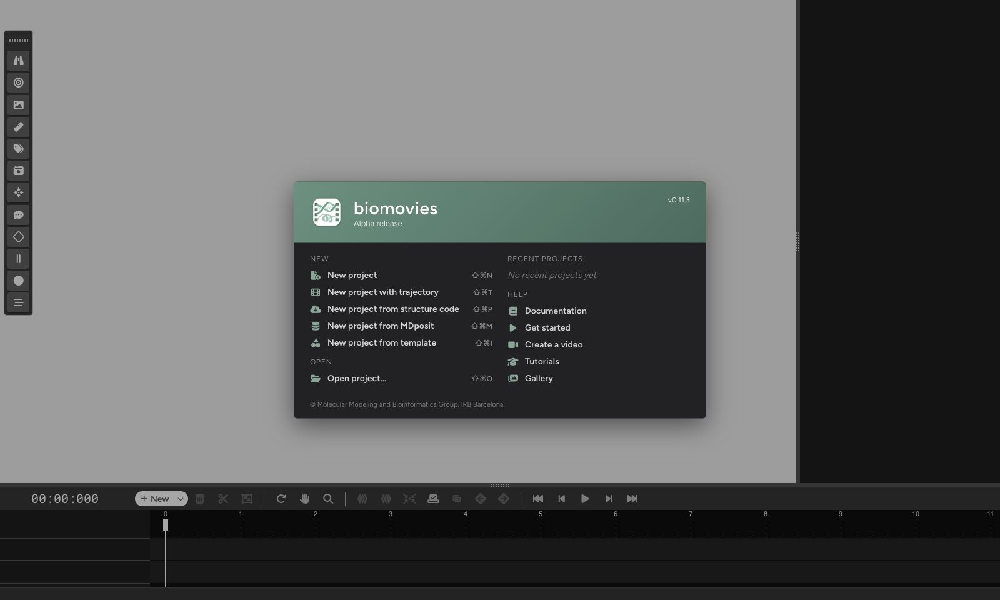
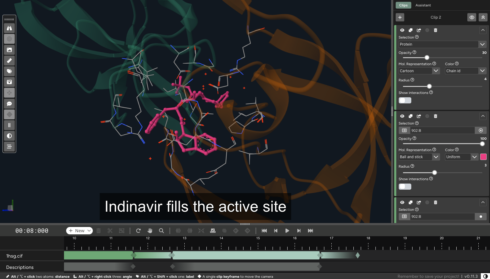
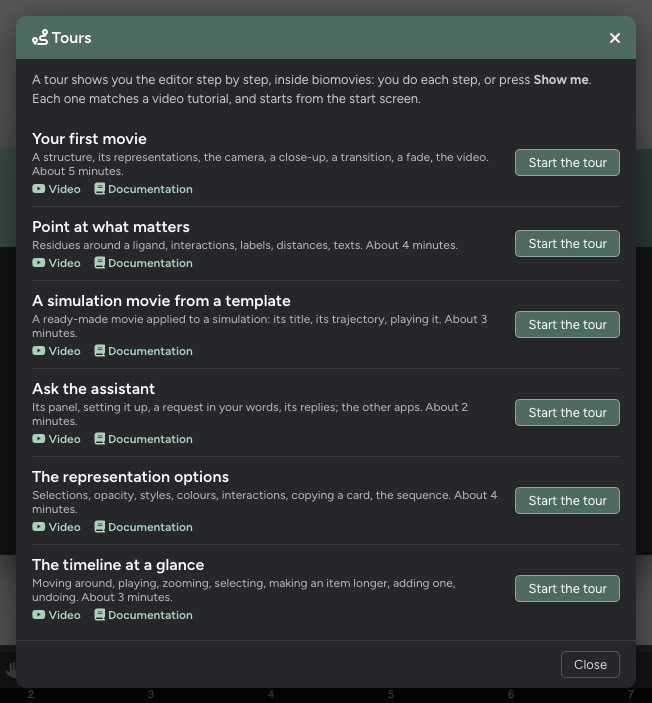
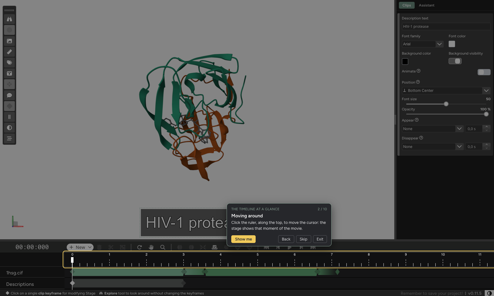
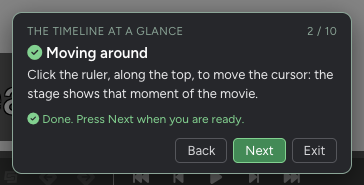

# Getting started

The start screen

When biomovies opens, the **start screen** offers every way to start a project. Behind it, the editor waits empty: it
can be used once a structure is open.

## Starting a project

| | Shortcut (macOS) | Shortcut (Windows, Linux) |
| :-- | :-- | :-- |
| **New project**: a structure file on your computer (**PDB** or **mmCIF**). | ⇧⌘N | Ctrl+Shift+N |
| **New project with trajectory**: a structure file (the topology) and its trajectory (**XTC**, **DCD** or **NetCDF**). | ⇧⌘T | Ctrl+Shift+T |
| **New project from structure code**: a **PDB ID** (from the PDBe), an **AlphaFold DB ID** or a **UniProt** accession (its AlphaFold model), downloaded for you. | ⇧⌘P | Ctrl+Shift+P |
| **New project from MDposit**: a simulation from the [**MDposit** <i class="fa-solid fa-up-right-from-square" style="font-size: 12px;"></i>](https://mdposit.mddbr.eu/) database, with its trajectory. | ⇧⌘M | Ctrl+Shift+M |
| **New project from template**: a ready-made movie (or one you saved as a template) applied to your structure. | ⇧⌘I | Ctrl+Alt+I |
| **New project with the assistant**: describe the movie you want; the [assistant](ai-assistants.html#the-assistant-in-biomovies) opens the structure and builds it. | ⌘L | Ctrl+L |
| **Open project…**: a **.biomovies** file. | ⇧⌘O | Ctrl+Shift+O |

The same entries are in the **Project** menu. On the right, **Recent projects** opens the last projects with one click,
and **Help** links to this documentation, the [tours](#tours), the tutorials and the gallery. When a new version of
biomovies is out, the start screen says so.

A few things to know:

* **From a structure code**, a PDB entry opens **as deposited**. Tick **Biological assembly** to open the assembly
  instead (for example the dimer of 6LU7, where the file holds one copy).
* **With a trajectory**, choose both files at once in the same dialog (keep them in the same folder). The trajectory
  must belong to that topology: check it first in a viewer such as [**VMD** <i class="fa-solid fa-up-right-from-square" style="font-size: 12px;"></i>](https://www.ks.uiuc.edu/Research/vmd/).
  A big trajectory takes a while to load, and makes the **.biomovies** file big: the project file keeps the structure
  and the trajectory inside. To share only the movie's settings, export it as a **template** (*Project > Export Project
  As Template*): a small file, without the structure.
* **From a template**, a window shows the ready-made templates, with a preview of each, and lets you choose your own
  **.tbiomovies** file. Then the start screen asks for the structure to use with it.

## The editor

The editor: the stage with the tools strip, the right panel, the timeline and the status bar

* **Stage**, in the middle: the structure as it looks at the timeline cursor. Drag to turn it, scroll to zoom. The
  **tools strip** on its left has the tools for the stage (background, measurements, labels, the camera...).
* **Right panel**, with two tabs. **Clips**: what is under the timeline cursor (for a clip, its **representations**,
  one card each; for a description, its text and style). **Assistant**: the [assistant in
  biomovies](ai-assistants.html#the-assistant-in-biomovies), to ask for a movie or a change.
* **Timeline**, at the bottom: the movie in time. The **+ New** button adds clips, transitions, fades and descriptions;
  the buttons next to it edit the timeline and play the movie. Below, a row for the structure's **clips** and
  **transitions**, and one for the **descriptions**.
* **Status bar**, at the very bottom: tips about what the mouse is over, whether the project is saved, the version.

## Your first movie

A short movie of the HIV protease with its inhibitor (PDB **1HSG**): the whole protein turning, then a close-up of the
inhibitor. About ten minutes.

**A tour in biomovies:** *Help > Tours…*, **Your first movie**, walks you through it in the editor ([Tours](#tours)).

**1. Open the structure.** On the start screen, click **New project from structure code**, type `1HSG` and click
**Open**. The editor opens with **one clip of 1 second** that shows every atom in ball and stick.

**2. Make the clip longer.** A clip starts and ends with a **keyframe** (the small diamonds in the timeline). Drag the
clip's last keyframe to the right, to about 5 seconds.

**3. Choose what it shows.** With the timeline cursor on the clip, the right panel shows its representation. Set
**Selection** to *Protein*, **Representation** to *Cartoon* and **Color** to *Chain id*. Then click **+** at the
top of the panel to add a second representation: *Ligand*, in *Ball and stick*, in a colour that stands out.

**4. Set the camera.** Click the clip's **first keyframe** and turn and zoom the structure on the stage: this is the
view the clip starts with. Click its **last keyframe** and turn the structure a quarter of a turn: while the clip plays,
the camera goes from the first view to the last. Press **Shift+P** (or the play button) to watch it.

**5. Add a second clip.** Double-click the clip's bar to select it (or ⌘+click, Ctrl+click), then **+ New > Cloned Clip After**: a copy with the same
representations, whose camera starts where the first clip ends. Make it 4 seconds long, as in step 2.

**6. Make it a close-up.** On the second clip, set the camera at its keyframes to a close view of the inhibitor (step 4).
On the protein's card, lower the **Opacity**, so that the inhibitor stands out and the protein stays as context.

**7. Join them with a transition.** A transition needs a little room: double-click the second clip to select it and drag it a bit
to the right, leaving at least 0.4 seconds between the clips. Click the **last keyframe** of the first clip, **Shift+click** the **first
keyframe** of the second, and choose **+ New > Transition**. During the transition, the camera flies from one clip to
the other and the representations fade from one to the other.

**8. Add a text.** Choose **+ New > Description**: the first description goes at the start of the movie, 1 second
long (drag its last keyframe to make it last as long as the first clip). Type its text in the right panel (for
example *HIV protease*) and choose where it goes on the screen.

**9. End with a fade.** Click the last keyframe of the second clip and choose **+ New > Fade Out**.

**10. Save and export.** Save the project with **Project > Save Project** (⌘S on macOS, Ctrl+S on Windows and Linux).
Then **Create Video > New Movie**: choose the size (720p to 4K) and click **Create video**. When it is done, watch it
in the window and click **Save…**.

Every step can be undone with **Edit > Undo** (⌘Z, Ctrl+Z).

## Tours

The tours window (Help > Tours…)

A **tour** shows the editor step by step, inside biomovies. **Help > Tours…**, or **Tours** on the start screen, lists
them: one per video tutorial, each with its video and its page of this documentation.

| Tour | What it shows | More |
| :-- | :-- | :-- |
| **Your first movie** | A structure, its representations, the camera, a close-up, a transition, a fade, the video window. | [Your first movie](#your-first-movie), [video <i class="fa-solid fa-up-right-from-square" style="font-size: 12px;"></i>](https://youtu.be/xTcXmQOIebw) |
| **Point at what matters** | The residues around a ligand, its interactions, a label, a distance, a text over the movie. | [The stage](editor-stage.html), [video <i class="fa-solid fa-up-right-from-square" style="font-size: 12px;"></i>](https://youtu.be/kFp-J5Ems3M) |
| **A simulation movie from a template** | A ready-made movie applied to a simulation: its title, its trajectory, playing it. | [Templates](templates.html), [video <i class="fa-solid fa-up-right-from-square" style="font-size: 12px;"></i>](https://youtu.be/v7sYMJRjmrQ) |
| **Ask the assistant** | The assistant's panel, its settings, a request in your words, its replies; the other apps. | [AI assistants](ai-assistants.html), [video <i class="fa-solid fa-up-right-from-square" style="font-size: 12px;"></i>](https://youtu.be/xLoqBcUJVDI) |
| **The representation options** | Selections, opacity, styles, colours, interactions, copying a card, the sequence. | [Representations](representations.html), [video <i class="fa-solid fa-up-right-from-square" style="font-size: 12px;"></i>](https://youtu.be/3frD4YCwcus) |
| **The timeline at a glance** | Moving around, playing, zooming, selecting, making an item longer, adding one, undoing. | [The timeline](editor-timeline.html), [video <i class="fa-solid fa-up-right-from-square" style="font-size: 12px;"></i>](https://youtu.be/FzyCwpzh73k) |

A step of a tour: the ruler lit, and the bubble that says what to do

Each step lights up the part of the window it is about, and its **bubble** says what to do. Do it yourself, or press
**Show me** and biomovies does it for you. A step done is ticked and waits for you:

A step done

| In the bubble | What it does |
| :-- | :-- |
| **Show me** | biomovies does the step for you, as you would: clicks, drags, menus. |
| **Next** | The next step, once this one is done. |
| **Skip** | The next step, without doing this one. |
| **Back** | The step before. A step you did is shown done. |
| **Exit** (or Esc) | Ends the tour. What it made stays. |
| **Finish** | On the last step, with the links to the tour's video and documentation: the tour is ticked in the tours window, and **Again** plays it once more. |

A step in a menu names it in the bubble (for example *Edit > Undo*), as a menu cannot be lit up.

**Where a tour starts.** On the start screen: if a project is open, biomovies asks first (to save it, when it has
changes) and closes it. Most tours make a small project of their own from files that come with biomovies (1HSG, the
HIV-1 protease and its inhibitor, and a short simulation for the templates tour): no download, the same every time. In
*Your first movie* you make the project yourself (**Show me** opens the 1HSG that comes with biomovies), and *Ask the
assistant* needs no key and sends nothing to a provider. What a tour made stays, an ordinary project: save it if you
want it. Closing it (**Project > Close Project**) ends the tour.

**The first time biomovies opens**, it offers the tours once (*New here? Take a tour*). Which tours you finished, and
whether they were offered, are kept in the file **tours.json**, in biomovies' settings folder:

* macOS: `~/Library/Application Support/biomovies` (the Library folder is hidden: in the Finder, **Go > Go to
  Folder…** and paste the path);
* Windows: `%APPDATA%\biomovies`;
* Linux: `~/.config/biomovies`.

Delete it to have the tours offered again the next time biomovies opens.

## What next

* The editor, area by area: the stage and its tools, the timeline, representations, trajectories and descriptions.
* [**Exporting videos**](create-videos.html): sizes up to 4K, 3D videos, animated GIFs, a part of the movie.
* [**AI assistants**](ai-assistants.html): ask the assistant in biomovies, or Claude Code, Claude Desktop, opencode or VS Code's Copilot to build a movie like this one for
  you.
* The [**tutorials** <i class="fa-solid fa-up-right-from-square" style="font-size: 12px;"></i>](https://mmb-irb.github.io/biomovies/#tutorials)
  and the [**gallery** <i class="fa-solid fa-up-right-from-square" style="font-size: 12px;"></i>](https://mmb-irb.github.io/biomovies/#gallery)
  on the website.
