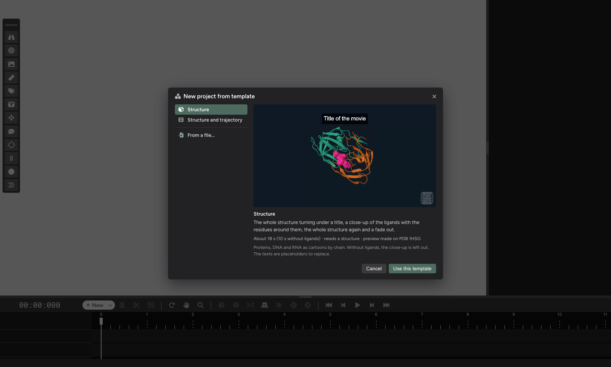

# Templates

The templates window

A **template** is a movie without its structure: its clips and their times, representations and cameras, transitions,
fades, descriptions, labels and measurements, and its trajectory settings. Applied to another structure, it makes the
same movie of it. A template file (**.tbiomovies**) is small, as it holds no structure and no trajectory: an easy way to
share how a movie is made.

## Starting from a template

**New project from template** on the start screen (⇧⌘I on macOS, Ctrl+Alt+I on Windows and Linux; also in the
*Project* menu) opens the **templates window**:

* **Ready-made templates**, each with a preview video made on an example structure, what it shows, how long it is and
  notes on what to expect:
  * **Structure**: the whole structure turning under a title, a close-up of the ligands with the residues around
    them, the whole structure again, and a fade out (about 18 s; 10 s for a structure without ligands, where the
    close-up is left out).
  * **Structure and trajectory**: a still overview under a title, the whole trajectory played while the camera turns,
    an ending played backwards, and a fade out (about 13 s).
* **From a file…**: a **.tbiomovies** file of your own. The window shows what it holds (its length, clips,
  transitions, descriptions, labels...) and what may not fit another structure (see below).

After **Use this template**, the start screen asks for the structure to use with it:

* for a structure template, a **structure file** or a **structure code** (PDB, AlphaFold DB, UniProt);
* for a trajectory template, the **structure and trajectory files** or an **MDposit** simulation.

**Back** returns to the start screen without a template. The texts of the ready-made templates are placeholders: change
them in the editor (see [Descriptions](descriptions.html)).

## Applying one to the open project

**Project > Apply Template…** opens the same window from the editor, with the templates that fit the open project
(with or without a trajectory). **Apply** makes a new project from the open one's structure (and trajectory, and whether
it shows the biological assembly) with the template. The open project is closed first, so biomovies asks to save it.

## Making your own

**Project > Export Project As Template** saves the open project as a **.tbiomovies** file: everything but the
structure and the trajectory.

What fits any structure and what may not:

* **Selections by keyword** (*Protein*, *Ligand*, `not water`...) fit any structure.
* **Selections naming residues, chains or atoms** (`25:A`, `:B`) only work where those exist; so do **labels** and
  **measurements**, which are on atoms. The templates window lists them before you use the template.
* A **trajectory** with a different number of frames: the clips' ranges are fitted to it.
